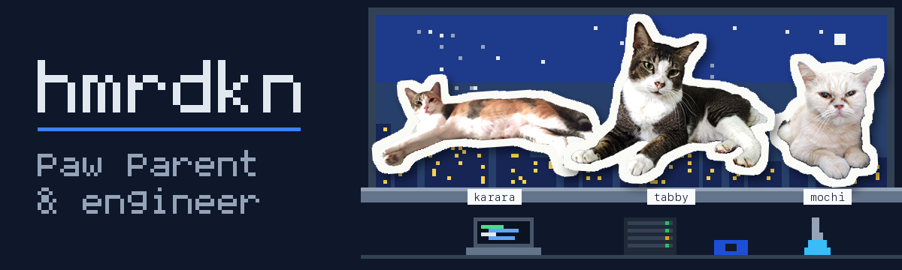

# Dika

`hamardikan` · **Software Engineer**

I build web applications, developer tools, and the infrastructure that keeps them reliable. My focus is useful products, repeatable delivery, and systems that are easy to inspect and maintain.

## Selected work

- **[LazySS](https://github.com/hmrdkn-labs/lazyss)** — A terminal cockpit for SSH and AWS Systems Manager sessions, with machine discovery, reachability checks, and local operator notes.
- **[Agent Awake](https://github.com/hmrdkn-labs/agent-awake)** — A macOS utility that keeps your Mac awake while coding agents work, then lets it sleep when they finish.
- **[Pak Satpam](https://github.com/hmrdkn-labs/pos-satpam)** — An MCP server that gives AI agents bounded, redacted observability and CI evidence, with operator approval required for failed-job reruns.
- **[Open Pajak](https://github.com/hmrdkn-labs/open-pajak)** — An open-source Indonesian tax calculator with transparent calculation breakdowns; inputs stay in the browser. Maintained with community contributors.
- **[DevOps learning system](https://github.com/hmrdkn-labs/devops)** — Portable lessons, guided practice, and spaced-repetition reviews covering Linux, containers, and Kubernetes.

## Elsewhere

[Website & writing](https://hamardikan.com) · [LinkedIn](https://www.linkedin.com/in/adhmrdkn/) · [hmrdkn-labs](https://github.com/hmrdkn-labs)
